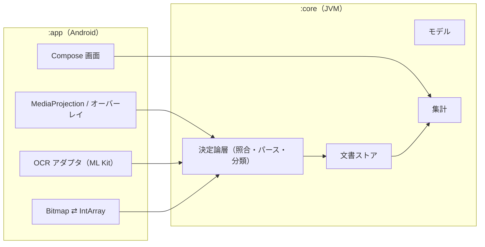

# 0007 モジュールを :app と :core に分ける

- 状態: 採用
- 日付: 2026-11-27
- 置換: なし

## 文脈

この題材の工数の大半は抽出にある（§6, §13）。ところが現状は単一モジュールで、`MainActivity` から何でも呼べる。抽出の判定（辞書照合、数値のパース、画面種別の分類）と集計（§9）は Android に依存しない純粋な計算なのに、置き場所が決まっていない。

単一モジュールのまま進めると、次の順で壊れる。

- 判定ロジックが `Context` や `Bitmap` を引数に取り始める
- テストに Robolectric かエミュレータが要る
- エミュレータは CI で重く、回帰テストを回さなくなる
- 回帰テストが無いので、テンプレートを1つ直すと別の画面が静かに壊れる

## 決定

1. **`:core`（JVM モジュール）** に、モデル・文書ストア・集計・抽出の決定論層を置く。`android.*` に依存しない。
2. **`:app`（Android モジュール）** に、Compose の画面、MediaProjection、オーバーレイ、OCR のアダプタ、Bitmap の読み書きを置く。
3. **境界はインターフェースで切る。** OCR は `:core` に `TextRecognizer` を定義し、ML Kit の実装は `:app` に置く。画像は `:core` では `IntArray`（輝度）として扱い、`Bitmap` は `:app` で変換する。
4. **`:core` に `android.*` が入ったら失敗させる。** 依存の検査をビルドに含める。

## 理由

- 決定論層と集計を JVM の単体テストで回せる。エミュレータ無しで済むので、CI で毎回動かせる
- 境界が機械的に強制されるので、判定ロジックに `Context` が紛れ込まない
- テンプレートの版を上げるとき、どの画面が壊れたかをテストで特定できる

## 影響

- モジュールが1つ増える。`:core` から `:app` への依存は作れない
- Hilt は `:app` のみ。`:core` はコンストラクタ注入で完結させる
- `:core` のテストは `./gradlew :core:test` で、実機も SDK も要らない

## 戻す基準

`:core` が Android API を必要とする具体的な理由が出たとき（描画・センサ・暗号化など）。そのときも、JVM で動く範囲は `:core` に残す。全部を `:app` に戻す判断はしない。
