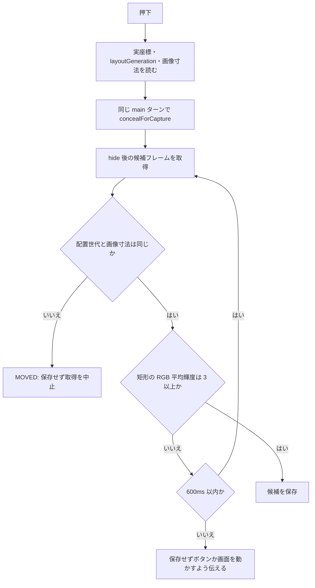

# 0012 取得ボタンを隠し、黒い矩形が消えたフレームだけを保存する

- 状態: 採用
- 日付: 2026-11-28
- 置換: ADR 0002 の押下時フレームを保存する記述（「置換する記述」で特定）

## 文脈

画面録画中は、取得ボタンのオーバーレイ自身が投影フレームに写り込む。従来の設計は「押下時のフレームを先に確保してから隠せば、バッファから取るので焼き付かない」としていた。しかし、押下時のフレームには既にボタンが写っているため、この順序では焼き付きを除去できない。

ボタンを隠した後のフレームを保存するには、そのフレームで本当にボタンが消えたかを判定する必要がある。同時に、隠している間の移動・回転で検査する矩形がずれてはならない。

## 検討した4案

| 案 | 判断 | 実測に基づく理由 |
| --- | --- | --- |
| フレーム時刻で hide 後かを判定する | **最終判定には却下**。候補を絞る一次フィルタにだけ使う | `Image.getTimestamp()` は合成時刻ではなく `queueBuffer()` の時刻である。hide 前に合成されたフレームにも hide 後の時刻が付き得るため、時刻だけでは「hide 後に合成された絵」を証明できない |
| 押下時と候補の矩形を平均絶対差で比較する | **却下** | ボタンが写ったまま下の絵だけが動いた条件で、平均絶対差は **91.17** だった。背景の変化とボタンの消失を区別できない |
| `FLAG_SECURE` だけで焼き付きを消す | **却下** | 投影でもスクリーンショットでも窓の矩形が純黒 **(0,0,0)** になった。下の絵は透けず、黒い矩形をそのまま保存すれば画像を壊す |
| `FLAG_SECURE` の黒い印と hide を組み合わせる | **採用** | 純黒 **(0,0,0)** の印は下の絵の動きに左右されない。黒い候補を棄却し、非黒を確認したフレームだけを保存できる |

## 決定

1. **取得ボタンの窓に `FLAG_SECURE` を付ける。** 投影フレームに残る完全な黒を「ボタンがまだ写っている」ことの決定的な印として使う。
2. **押下時にボタンの実座標、`layoutGeneration`、画像寸法を読み、同じ main ターンで `concealForCapture` により hide する。** 読み取りと hide の間に suspend を挟まない。押下時のフレームは保存対象にしない。
3. **hide 後の候補フレームを検査する。** フレーム時刻は候補を絞る一次フィルタに留め、最終判定には使わない。`layoutGeneration` または画像寸法が変わっていたら `MOVED` として保存せず、その取得ごと中止する。隠している間も `DisplayListener` を止めず、回転・再配置を検出する。
4. **配置が同じなら矩形の黒を見る。** RGB 平均輝度が 3 未満なら黒い印が残っている候補として捨て、次のフレームで撮り直す。3 以上の非黒ならボタンが消えた候補として保存する。
5. **600ms で打ち切る。** 検証できない画像は保存せず、人間に「**ボタンを動かすか、画面を動かしてください**」と伝える。新しいフレームが来ない場合も推測で保存しない。

## 理由

- 黒い矩形はボタンが残っていることの決定的な印なので、下の絵が動いても「消えた」と誤判定しない
- 実矩形の読み取りと hide を同じ main ターンで行い、配置世代も比較すれば、古い矩形だけを見て移動先の黒を見逃す事態を防げる
- 判定できないときに保存しないことで、焼き付いた画像や黒く潰れた画像を成果物に残さない

## 限界

- **ボタンの下が真っ黒な画面では保存できない。** ボタンを隠した後も黒いままなので、黒い印と正常な背景を区別できない。600ms で打ち切り、人間にボタンか画面の移動を委ねる
- **ゲーム側の暗い画面でも中止になり得る。** 真っ黒に近く、矩形の RGB 平均輝度が 3 未満の候補は黒い印と区別せず棄却する
- **隠している間に位置・回転が変わったら中止する。** `layoutGeneration` が進んだ取得を続けず、古い矩形では判定しない
- **600ms が上限である。** それまでに非黒の候補を検証できなければ保存しない
- 保存するのは押下時の画像ではなく、hide 後に検証できた候補である

## 実機の証跡

検証端末（API 37）で確認した。個人情報や端末の識別子は記録しない。

| 確認項目 | 結果 |
| --- | --- |
| `FLAG_SECURE` を付けた窓の投影 | 窓の矩形が純黒 **(0,0,0)** になった |
| `FLAG_SECURE` を付けた窓のスクリーンショット | 投影と同様に窓の矩形が純黒 **(0,0,0)** になった |
| 下の絵との関係 | 下の絵は透けず黒で塗られる。焼き付きを消す用途には使えないが、動く背景に強い決定的な印になる |

## 影響

- 取得は「押下時のフレームを確保」ではなく「hide → 候補の配置と黒を検証 → 保存」に変わる
- 検証できない場合は操作がやり直しになる。これは誤った画像を保存しないための意図した失敗である
- `FLAG_SECURE` を単独の対策とみなさない。黒い矩形の検査と配置世代の確認をセットで維持する

## 置換する記述

既存の ADR は書き換えず、この ADR で次の記述を置換する。ADR 0002 の「画面録画＋オーバーレイの取得ボタンを既定にする」という決定自体は維持する。

| 文書 | 置換する記述 | 新しい扱い |
| --- | --- | --- |
| ADR 0002「決定」「理由」 | 「オーバーレイの取得ボタンを押した時点のフレームを保存する」「押した瞬間のフレームがバッファから取れる」 | hide 後に検証した候補を保存する |
| ADR 0002「帰結」 | 「押下時はバッファからフレームを先に確保し、その後でボタンを非表示にする順序にする」 | 実矩形と配置世代を読み、同じ main ターンで hide してから候補を検査する |
| 設計 v0.8 §4.1 | 「押下時のフレームを先に確保してから隠す順序にする（バッファから取るので焼き付かない）」 | 本 ADR の決定に置換する |
| 設計 v0.8 §4.5・§11 | 「押した時点のフレームが確実に残る」「押した瞬間のフレームを確実に残せる」 | hide 後の候補を検証し、確認できない場合は保存しない |
| 設計 v0.8 §12 | 「押下時にバッファから先にフレームを確保してから非表示にする」 | `FLAG_SECURE`・同じ main ターンでの hide・黒い矩形と配置世代の検査に置換する |

設計書は v0.9 で上記を訂正し、あわせて §13 の M1 検証項目を保存画像の検証に合わせ、§14 の `FLAG_SECURE` と非表示ラグの項目を実測済みに更新した。

## 戻す基準

黒い矩形が「ボタンがまだ写っている」印として成立しない環境や、非黒の候補に焼き付きが残る実測が見つかった場合は、この方式を置換する ADR を起こす。その場合も、時刻や平均絶対差だけを最終判定に戻さない。
