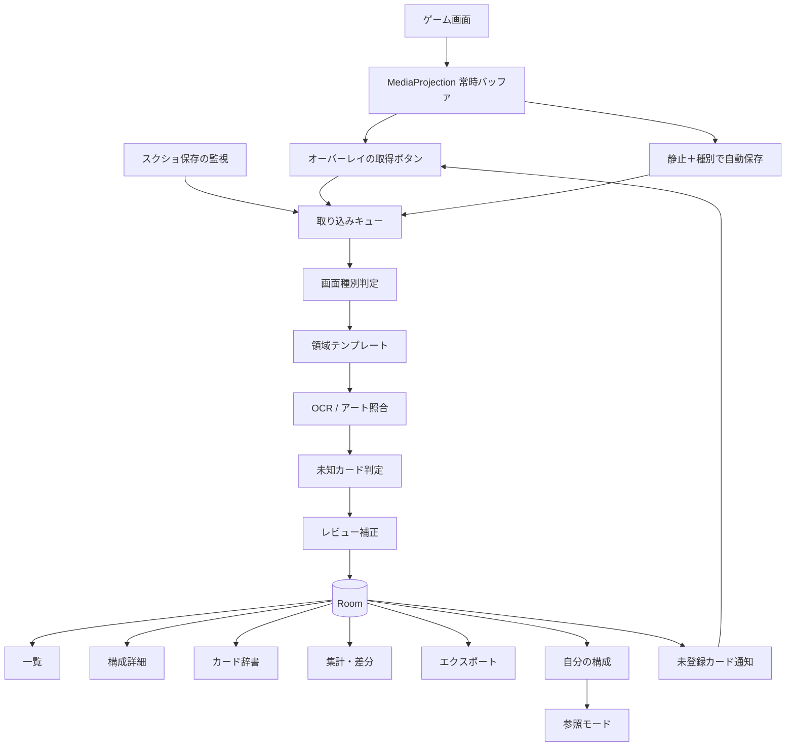
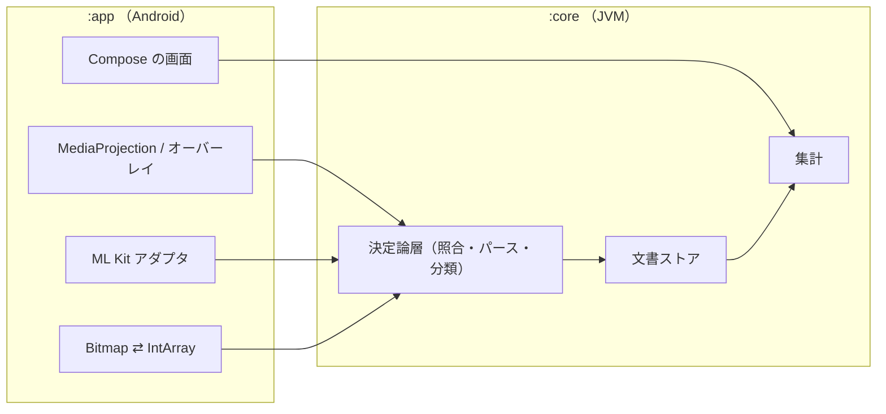
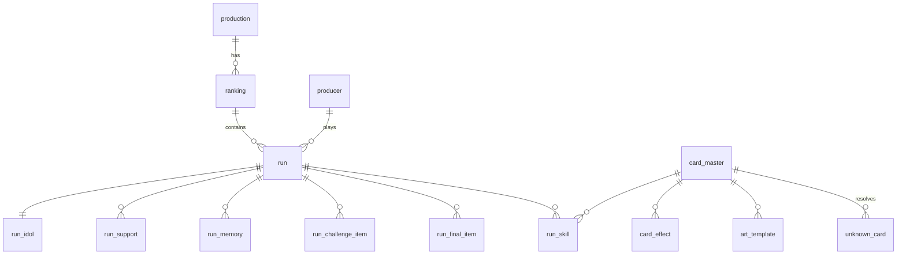

# hatsu-desk（学マス ランキング構成ビューア） — 設計 v0.9

2026-11-28 / 状態: 提案（未承認）

> v0.9 の変更: オーバーレイの焼き付き対策を実測と実装に合わせた。押下時のフレームをそのまま保存するのではなく、同じ main ターンでボタンを隠し、`FLAG_SECURE` の黒い印と配置世代で検査したフレームだけを保存する（§4.1、ADR 0012）。
>
> v0.8 の変更: §3.2 に `:core` の JDK API を `minSdk` の Android API 面に収める制約を追加した。判定基準と検査の適用範囲は ADR 0011 に記録。

> v0.7 の変更: M0 の実装設計を追加した（§3.2 モジュール構成、§8.6 M0 で作るもの、§13 受入条件）。モジュール分割・OCR・カード辞書・通信権限の4件を ADR 0007〜0010 に記録。§13 で M0 の検証項目が M5 の集計と重複していたのを訂正した。

> v0.6 の変更: wiki と突き合わせてゲーム側の仕様を確認し、§2.2 を追加。評価点・ランク上限・難易度・ランキング2系統・編成枠を確定させ、`run.score_pt` を `eval_point` に、`ranking` に `kind` を追加した。評価点は逆算できないので計算しない（ADR 0006）。プロジェクト名を hatsu-desk に変更。

> v0.5 の変更: ビルド環境を確定した（ADR 0005）。desktop の rootless podman で `--rm` の都度起動し、イメージはリポジトリ管理。ツールチェーンの版を §11 に固定した。実装は private リポジトリ `denebola213/gakumas-deck-viewer`。

> v0.4 の変更: ランキングの単位を `ranking`（公演×シーズン×難易度×Pアイドル）として独立させ、プレイヤーを `producer` に分離した（§2.1, §8）。ADR 0004 を追加。

> v0.3 の変更: 永続化を Room（正規化）から文書指向（1件1ファイル＋インメモリ索引）に変更（§11.5）。設定は引き続き DataStore。

> v0.2 の変更: 取得方式を「画面録画＋オーバーレイの取得ボタン」に変更（ADR 0002）。カード詳細（ポップアップ／全画面）を第一級のデータとして取り込み、カード辞書を詳細撮影で育てる方式にした。サポートの集計を単体採用率からセット・ペア・型に変えた（ADR 0003）。
>
> v0.1 の変更: 収集コストを実測に置き換え、共有シートを主経路から外した。件数目標を必要 N から逆算する方針を追加。

## 0. 目的と非目的

**目的**: ランキングの各エントリから「プロデュース履歴」＝構成（Pアイドル、サポート6、メモリー4、チャレンジPアイテム、最終所持Pアイテム、最終所持スキルカード最大33）を端末内に蓄積し、横断して一覧・集計する。カード詳細も同じ DB に入れ、参照できるようにする。将来は自分の構成を組んでプレイ中に参照する。

**非目的**: 自動操作、ゲーム通信の解析、アカウント連携、他者への公開・共有サービス、スクレイピング代行。

## 1. 制約（設計の前提）

| 制約 | 設計への帰結 |
| --- | --- |
| サーバーを置かない | `INTERNET` 権限を**宣言しない**。CI で manifest を検査し、依存に OkHttp 等が入ったら失敗させる |
| 操作は人間が行う（規約違反の回避） | 自動タップ・`AccessibilityService` による画面読取・メモリ読取・パケット傍受を実装しない |
| 取得源は画面の画像のみ | 入力は1画面1枚。画面遷移とスクロールは人間が行う |
| ゲーム画像を再配布しない | カード辞書を APK に同梱しない。端末上で育つ辞書にする（§8.5） |
| 端末の容量を過剰に使わない | 元画像は既定で破棄、クロップ（96px webp）とカードマスタのサンプルのみ保持 |
| 一覧化が主目的 | 取り込みは入口。価値の中心は集計（§9）に置く |
| **人間の操作量が唯一の制約** | 1件あたりの操作数を設計指標にする（§4.5）。目標件数は集計の必要 N から逆算する（§9） |

## 2. 画面から取れるデータ（実測）

| 画面 | フィールド | 型 |
| --- | --- | --- |
| A. ランキング（アイドル別 TOP100） | 公演名、開催状態、シーズン、開始日時、選択中アイドル（顔・楽曲名・名前）、順位、サムネ、プレイヤー名、評価（S4/SS+/C++）、Pt、Top100 バッジ | 文字・数値・画像 |
| B. プロデュース履歴 上部 | 公演、難易度（レジェンド）、日付、プレイヤー名、PLv、評価、Pt、Top100 バッジ、サムネ | 文字・数値 |
| B. Pアイドル | レアリティ、カード名、アイドル名、Vo/Da/Vi 実数と%、体力、星、凸 | 文字・数値 |
| B. サポート | 6枚（2列×3行）、Lv、特訓、レンタル札 | 画像＋数値 |
| B. メモリー | 4枚（縦1列） | 画像 |
| B. チャレンジPアイテム | 3個、各値（+30）、合計（+90） | 画像＋数値 |
| B. 最終所持Pアイテム | 4個、タグ（Pアイドル/サポート/なし） | 画像＋タグ |
| C. 最終所持スキルカード | 6列グリッド最大33（最終行3）。左上=強化値、右下=コスト(±, ×2)、属性アイコン、タグ（メモリー/サポート） | 画像＋微小数値 |
| D-1. Pアイテム詳細（ポップアップ） | 名前、効果行（アイコン＋文）、使用条件（「レッスン中1回」等） | 文字 |
| D-2. チャレンジPアイテム詳細（ポップアップ） | 名前、条件文、効果行、特殊効果 | 文字 |
| D-3. サポートカード詳細（全画面） | カード名、レアリティ、Lv、スキルカードサポート（レッスン種別／確率）、サポートイベント（獲得カード名＋効果2行）、サポートアビリティ6行（アイコン＋文＋数値） | 文字・数値 |
| D-4. スキルカード／メモリー詳細 | **未確認**（タップで詳細が出るか実機で確認） | — |

画面 A は1画面に6〜7行 → 100件で15スクロール前後。画面 B/C はスクロールで2枚に分かれる。画面 D は1件1枚で完結する。

### 2.1 ランキングの単位（v0.2 で誤っていた）

ランキングは**プロデューサー（プレイヤー）ごと**に並び、しかも**Pアイドルごとに別のランキング**になっている。画面 A の上部に選択中アイドルのカードがあり、下部にアイドル切替タブがある。したがって:

- 順位は「ある公演・シーズン・Pアイドルのランキング」の中での順位。全体のスコア順ではない
- 同じプレイヤーが複数のアイドルでランクインしうる（例: ハーオタ@FoG が複数いる）
- ランキングの識別子は `(公演, シーズン, Pアイドル)`。難易度が分離軸かは未確定（§14）
- ランキングの Pアイドルは**キャラクター**単位、履歴に出る Pアイドルカードは**使用カード**単位。同じキャラの別 SSR がありうるので両方を持つ
- 索引の収集は「アイドル切替1回＋15スクロール」を人数分。14人でも数分

v0.2 までは `run.player_name` を文字列で持っていたが、これでは同一プレイヤーの追跡ができない。`producer` を独立させる（§8）。

### 2.2 ゲーム側の仕様（wiki で確認した）

| 項目 | 確認した内容 |
| --- | --- |
| 評価点 | パラメータ分＋中間試験＋最終試験（順位・スコア換算）の合計。画面の「26,547Pt」は**評価点**であって試験スコアではない |
| 評価ランク | 26000〜=S4、30000〜=S4+、35000〜=S5。上限はシナリオ別（『初』レジェンド=S4、『初』レギュラー/プロ/マスター=SS+、N.I.A=SSS+、H.I.F=S5） |
| 難易度 | レギュラー／プロ／マスター／**レジェンド**の4段階。レジェンドは親愛度10以上かつ PLv50 以上で解放 |
| ランキング | 2系統ある。①プロデューサーランキング（レギュラー・プロ・マスター）、②Pアイドル別ランキング（レジェンド、シーズン制、TOP100）。画面Aは② |
| 編成枠 | サポート6（自前5＋レンタル1）、メモリー4（自前3＋レンタル1）、チャレンジPアイテム3（各+20%/+30%、合計+90） |
| デッキ | 攻略記事の典型は26〜30枚。画面Cの実測は33枚。上限の明記は見つからない |

**評価点は計算しない。** wiki 内でパラメータ係数が 2.1 と 2.3 の両方が出ており、スクショの実数（Vo1810＋Da2883＋Vi1740＝6433、評価点26,547）からも逆算できない。観測値として保存し、並び替えと比較にだけ使う。

**画面の % は保存しない。** 19.5/42.0/35.8 は和が97.3で、実数比（28.1/44.8/27.0）とも wiki のアイドル別比率（咲季は『初』全難易度 27/33/40）とも一致しない。規則を特定できない以上、実数から計算し直す。

評価点は構成だけで決まらない（最終試験のスコアと順位が最大で数千点を占める）。構成の比較では評価点の差を構成由来と読まないため、パラメータ合計を併記する（§9）。

## 3. アーキテクチャ



層は 5 つ。入力 → 認識 → 未知判定 → 補正 → 蓄積と提示。認識層は DB に直接書かず、`Draft` を経由して補正後に確定する。未登録カードの通知が入力側に戻るループを持つ（§8.5）。

## 3.2 モジュール構成（v0.8）

`:core` は JVM だけで動く。`:app` が Android に触る。判断は ADR 0007。



| モジュール | 置くもの | 置かないもの |
| --- | --- | --- |
| `:core` | モデル、文書ストア、集計、辞書照合、数値パース、画面種別の分類 | `android.*`、`Context`、`Bitmap`、ML Kit |
| `:app` | Compose の画面、MediaProjection、オーバーレイ、ML Kit のアダプタ、Bitmap の入出力、Hilt | 集計の計算、パース規則、照合の閾値 |

`:core` は JVM モジュールだが、出荷対象コードで使う JDK API は `minSdk 26` の Android API 面に存在するものに限る。JVM テストの成功は Android で動くことの証明にはならない。判定基準と検査で守れる範囲は ADR 0011 に従う。

境界は検査で強制する。`:core` の依存に `android.*` が現れたらビルドを失敗させる。判断の理由は ADR 0007。

## 4. 取り込み経路

**v0 は手間を「小」と見積もって誤った。** ボトルネックは認識ではなく輸送（撮る→共有→取り込む）と件数だった。v0.2 では画面録画を既定にする。

| 経路 | 権限 | 1件の操作 | 規約リスク | 判断 |
| --- | --- | --- | --- | --- |
| 画面録画＋オーバーレイの取得ボタン | 収録の同意（セッション毎）＋常駐通知 | 5〜6 | 中 | **既定** |
| 画面録画＋静止・種別で自動保存 | 同上 | 3〜4 | 中 | 設定で有効化 |
| スクショ保存の自動監視（MediaStore） | 画像読み取り | 5〜6 | 低 | 代替（録画を嫌う場合） |
| スクショ → 共有ターゲット | ゼロ | 9〜10 | 低 | 過去分のみ |
| AccessibilityService | 強力 | 0 | 高（自動化） | **採用しない** |

### 4.1 実装（常時バッファ＋ボタン）

- `MediaProjection` ＋ `VirtualDisplay` ＋ `ImageReader` でフレームを受け取り、**最新1枚を常に上書き保持**する。読み出してもバッファは消費しない。押下時点のフレームをそのまま保存対象にはせず、後述の検査を通ったフレームを保存する。
- オーバーレイ（`SYSTEM_ALERT_WINDOW`）に取得ボタンを置く。押下を契機に画面種別の判定と OCR へ渡す画像を保存するが、焼き付きを排除できない場合は保存しない。

「押下時のフレームを先に確保してから隠す」「バッファから取れば焼き付かない」という旧設計は誤りだった。検証端末（API 37）で確認した事実と設計への帰結は次の通りである。却下した案の経緯は [ADR 0012](../adr/0012-overlay-burn-in-black-marker.md) に記録する。

| 対象 | 実測・確認できた事実 | 設計への帰結 |
| --- | --- | --- |
| 取得ボタン | 投影の絵に合成される | 押下時のフレームを先に確保しても、ボタンの写り込みは避けられない |
| `Image.getTimestamp()` | 合成時刻ではなく、最後の sink への `queueBuffer()` の時刻を返す | 隠す前に合成された絵が hide 後にキューされ得るため、時刻だけでは「hide 後に合成されたフレーム」を選べない |
| 押下前後の平均絶対差 | ボタンが写ったまま下の絵が動くと、実測 **91.17** になった | 差の大きさをボタンが消えた証拠にはできない |
| `FLAG_SECURE` | 付けた窓の矩形は、投影でも OS のスクリーンショットでも純黒 `(0, 0, 0)` になった。下の絵は透けない | 焼き付きは消せないが、下の絵が動いても変わらない「ボタンがまだ写っている」ことの決定的な印として使える |

取得ボタンには `FLAG_SECURE` を付け、次の手順で保存する。

1. 押下時に、実 View の画面座標（矩形）、`layoutGeneration`、投影画像の寸法を読み、**同じ main ターンで suspend せずに `concealForCapture` でボタンを隠す**。位置を読んでから隠すまでにドラッグや回転を挟まない。位置を読めない、矩形が画像の外、または隠せなかった場合は保存しない。
2. hide 完了時刻以降にキューされたフレームを候補にする。ただし `Image.getTimestamp()` は候補を絞る一次フィルタにだけ使い、焼き付きが消えた証拠にはしない。
3. 候補の `layoutGeneration` または画像寸法が押下時と変わっていたら `MOVED` として**その取得ごと中止**する。同じ取得を新しい矩形でやり直さない。隠している間も `DisplayListener` を止めず、回転・再配置を検出する。画像寸法はセッション中の不変条件の確認であり、回転の検出は配置世代で行う。
4. 配置が同じなら、隠す直前の実座標の矩形を調べる。黒い印が残っている候補は捨て、それより新しいフレームで撮り直す。黒くない候補を写し取ってボタンを表示へ戻し、その画像を保存する。押下前のフレームとの平均絶対差は使わない。
5. hide から **600ms** 以内に保存できるフレームを確認できなければ、保存せず、人間に**「ボタンを動かしてください」**と伝える。新しいフレームが来ない場合も推測で保存しない。

**ボタンの下が真っ黒な画面では保存できない。** ボタンを隠した後も矩形が黒いままなので、600ms で中止して人間にボタンを動かしてもらう。オーバーレイ未許可で隠すボタンが無い場合は、新しいフレームを待たずに最新1枚を保存する。

連続投影は電池と発熱を食う。セッション制にして「1アイドル分を撮ったら終了」を促す。

### 4.2 自動保存（任意）

画面種別の confidence が高く、かつ差分が 300ms 以上止まったら自動で保存する。人間は「開く→スクロール→閉じる」だけでよい。誤爆（遷移中・ポップアップ）は種別判定で弾き、確信が持てないものは捨てる。既定はオフ。

## 4.5 収集コストの分解

1エントリ（1人分の構成）を取る操作を数える。

| 方式 | 内訳 | 計 |
| --- | --- | --- |
| 初案（共有） | 開く1＋スクショ2＋スクロール1〜2＋閉じる1＋共有2＋取り込み確認1 | 9〜10 |
| スクショ監視 | 開く1＋スクショ2＋スクロール1〜2＋閉じる1 | 5〜6 |
| **録画＋取得ボタン** | 開く1＋ボタン2＋スクロール1〜2＋閉じる1 | 5〜6 |
| 録画＋自動保存 | 開く1＋スクロール1〜2＋閉じる1 | 3〜4 |
| 索引のみ（画面A） | スクロールのみ（1画面7件） | 0.2/人 |
| カード詳細 1枚 | 開く1＋ボタン1＋閉じる1 | 3 |

ボタン方式はスクショ監視と同じ操作数だが、**確実性**が違う。OS のスクショはタイミングとジェスチャに依存し、ポップアップのように一瞬で消える画面を取り逃す。バッファ方式では押下を契機に最新フレームを検査できるが、押した時点の絵を無条件に保存するわけではない。黒い印が残る、配置が変わる、新しいフレームが来ない場合は保存せずに中止する（§4.1）。

**カード詳細のコストは構成の件数ではなくカードの種類数に比例する。** 一度撮れば全構成で使い回せるので、初期（未登録50種で150操作）が重く、以後は逓減する。ここが他の収集と性質が違う点。

設計原則は「**安いデータは広く、高いデータは狭く**」。

- 索引（順位・名前・評価・Pt）は100人でも15枚。全アイドル分を揃えても数分。→ 広く取る
- 構成は1人あたり3〜6操作。100人×14アイドルは論外。→ 狭く取る
- カード詳細は種類数に比例。→ 出現回数の多い未知から潰す

実測の目安（1操作2秒＋遷移待ち）:

| 対象 | 操作数 | 実時間 |
| --- | --- | --- |
| 索引 1アイドル（100人） | 15 | 40秒 |
| 構成 上位10人 | 55 | 3分 |
| 構成 上位20人 | 110 | 6分 |
| 構成 上位100人 | 550 | 30分 |
| カード詳細 50種 | 150 | 10分 |

## 5. 座標系と画面判定

- ゲームは縦固定・内部解像度固定で描画され、端末差はレターボックス（余白）として現れる。したがって「コンテンツ矩形を検出 → 内部座標へ正規化」で座標系を1本化できる。端末ごとのテンプレートは不要。
- 検出は外周走査（背景の薄い菱形パターンの開始位置）＋失敗時はアスペクト比からの推定。
- 画面種別は特徴アンカーで判定する：「最終所持スキルカード」見出しの有無、「TOP100」見出し、行の縞間隔、ポップアップの角丸矩形。未知は「未分類」で保留。
- テンプレートは assets の JSON（正規化座標の矩形リスト＋`version`＋`signature`）。レイアウト変更時はアプリ更新なしで差し替え、崩れたら矩形をドラッグで作り直すキャリブレーションモードを用意する。

## 6. 抽出パイプライン（二層）

**第一層（決定論）**: 辞書照合。アイドル名14人、難易度、公演名は固定辞書。OCR 結果は編集距離で寄せる。数値は数字専用の前処理（2値化・拡大・全角/カンマ補正）をかけてからパースする。

**第二層（学習）**: カードアートの照合。

- タイル切り出し → 128px 正規化 → pHash（DCT 64bit）＋ HSV ヒストグラム
- ハミング距離 ≤ 8 を同一候補とし、上位3件を提示。確定は閾値以下のみ自動
- レンタル札・Top100 バッジ・未所持フィルタは重なりなので、照合前にマスクする領域をテンプレートに持たせる
- 特訓前後で絵が変わるカードは別 ID として学習される（結果的に正しい）
- pHash はスケール不変なので、構成画面の小さいアートと詳細画面の大きいアートを同じ辞書で照合できる

**v0.1 では「未知タイルをクラスタ化して1回だけ命名する」としていたが、v0.2 で命名工程を廃止する。** カード詳細を撮れば名前・アート・効果文が同時に入るので、命名が不要になる。詳細の大きなアートはそのまま高精度なテンプレートになる。

## 7. 完了度とレビュー

| レベル | 範囲 | 1件あたりの操作 | 位置づけ |
| --- | --- | --- | --- |
| L0 | 順位・名前・評価・Pt・アイドル（画面A） | 0.2（スクロールのみ） | **索引**。全件取る |
| L1 | 編成（サポート6・メモリー4・アイテム・パラメータ） | 5〜6 | **本体**。上位N件だけ |
| L2 | 最終所持スキルカードのアート | ＋1（同じ画面の続き） | 本体。L1と同時に取れる |
| L3 | カードの強化値・コストまで | ＋レビュー時間 | 例外。数件だけ |

v0 では「L0 が100件あれば一覧が成立する」と書いたが、これは誤り。L0 は構成を持たないので単体では価値が薄い。L0 の役割は**索引と取得ガイド**（誰を開くべきか、どこが未取得か）であって達成目標ではない。

L1/L2 は同じ詳細画面の上下なので、1エントリを開けば同時に取れる。分ける意味は「上部だけ取って下部は捨てる」判断を許すことにある。

**完了度は2軸にする。** 構成レコードの L0〜L3 と、カード辞書の充足率（既知の種類数 ÷ 出現した種類数）は別物。前者は件数に比例し、後者は種類数に比例する。

レビューは**後回し・まとめて・放置可**を原則にする。confidence が閾値未満のフィールドは「不明」として保存し、集計から除外する。撮った直後に全部直させる UI は、それ自体が手間を特大にする。確定は「保存」1タップ、直したい人だけ詳細を開く。

## 8. データモデル

`buildToolsVersion`以下は**論理モデル**。物理は文書（1件1ファイル）で持つ（§11.5）。



| テーブル | 主な列 |
| --- | --- |
| `production` | id, title, started_at |
| `ranking` | id, production_id, season, difficulty, kind(producer/p_idol), p_idol_char_id(NULL可), started_at, ended_at, captured_at |
| `producer` | id, name, name_norm, thumb_phash, first_seen |
| `run` | id, ranking_id, producer_id, session_id, rank, plv, grade, rank_cap, eval_point, param_total, badge, played_on, completeness, note |
| `run_idol` | run_id, card_id, char_id, rarity, vo, da, vi, stamina, star, limit_break |
| `run_support` | run_id, slot(0-5), card_id, level, training, rental |
| `run_memory` | run_id, slot(0-3), card_id, rental |
| `run_challenge_item` | run_id, slot(0-2), item_id, lesson_cap_bonus_pct(20/30) |
| `run_final_item` | run_id, slot(0-.., 実測4), item_id, tag |
| `run_skill` | run_id, idx(0-.., 実測33・典型26〜30), card_id, enhance_from, enhance_to, cost, cost_mod, attr, tag |
| `card_master` | card_id, kind(support/skill/item/memory/p_idol), name, char_id, rarity, lesson_type(vo/da/vi/any), probability, attr, cost, condition, source, detail_ok |
| `card_effect` | card_id, section(event/ability/skill/item), idx, icon, text, numbers_json |
| `art_template` | id, phash, hist, card_id, scale(big/small), sample_path, hits |
| `unknown_card` | id, phash, hist, count, first_seen, sample_path, resolved_card_id |
| `capture` | id, session_id, uri, screen_type, template_version, source(button/auto/mediastore/share), meta |

物理索引は持たない（§11.5）。メモリ索引は `(ranking_id, eval_point)` の並び、`card_id → run_support / run_skill` の逆引き、`unknown_card(count)` の順。起動時は `index/runs.idx` の要約だけ読み、集計を開いたときに全件ロードする。

容量: クロップ 96px webp × 約43枚 ≈ 150KB/件 → 100件で 15MB。カードマスタのサンプルは 1種 1枚 256px webp ≈ 20KB → 500種で 10MB。元画像は既定で破棄。

`session_id` は「同じ詳細画面の上下2枚を1件に束ねる」ためのキー。run の自然キーは `(ranking_id, producer_id)` で、束ねと重複排除の両方にこれを使う（同じランキングに同じプレイヤーは1件しか出ない）。

`run.eval_point` は画面の評価点をそのまま持つ。`rank_cap` はシナリオ・難易度ごとの上限ランク（『初』レジェンドなら S4）で、上限に張り付いた run を見分けるために持つ。`param_total` は Vo+Da+Vi の合計で、評価点の比較から実力差を切り分けるためのもの。

`producer` の同一性は名前とサムネの pHash で判定する。ゲーム内に ID が無いので、名前を変えたプレイヤーは別人として扱う。同名の別人も別人のまま残す。誤って統合するより分離した方が後から直せる。

## 8.5 カード辞書を詳細撮影で育てる

**課題**: 構成画面のカードはアートだけで、名前も効果も分からない。v0.1 は人力命名で補う設計だった。

**v0.2 の解**: カードをタップすると出る詳細画面を取り込む。詳細1枚で名前・レアリティ・レッスン種別・効果文・大きなアートが同時に入るので、**命名工程が消える**。

```
構成を撮る → 未知のアートを検出 → unknown_card に積む
   → セッション終了時にまとめて通知「未登録カード 7種」
   → オーバーレイにバッジ。一覧を開くとサムネと出現回数が出る
   → 人間がゲーム内でそのカードを開き、取得ボタン
   → 詳細がOCRされ、unknown_card と照合して紐付け
   → card_master 完成。以後は既知として自動照合
```

- 通知は個別に鳴らさない。セッション終了時に1回だけ、出現回数の多い順にまとめる
- 一覧には「どこで開けるか」のヒントを出す（編成サポート／最終所持スキルカード／Pアイテム）
- 効果文は**全文をそのまま保存し、FTS で検索する**。自然文を構造化しても使い道がないので、構造化するのはレッスン種別・アイコン種別・抽出できる数値だけ
- 未知のまま残ったものは「未詳カード」として構成に記録され、集計では別枠にまとめる（欠損として捨てない）

## 8.6 M0 で作るもの（v0.7）

M0 は手入力しかない。OCR もアート照合も無い状態で、データモデルと画面が成立するかを確かめる段階。

| 画面 | 内容 | M0 で要る理由 |
| --- | --- | --- |
| 一覧 | ranking ごとに run を評価点順に並べ、`param_total` を併記 | データモデルが一覧に足りるか |
| 構成詳細 | Pアイドル、サポート6、メモリー4、アイテム、スキルカード | 1件を木として読めるか |
| カード辞書 | 登録済みカードの閲覧。空から始まる | 未詳を前提にした UI になっているか |
| 手入力 | run を1件作る。フィールドは任意、空は「不明」 | 入力の手間が現実的か |

保存先は §11.5 の物理配置に従う。

- `files/runs/<run_id>.json` … 1件1ファイル
- `files/cards/<card_id>.json` … カード辞書（M0 では空）
- `files/index/runs.idx` … 起動時の要約。壊れても再生成できる
- `files/crops/`, `files/cards/art/` … M1 以降。M0 では作らない

受入条件は §13 に置く。

## 9. 一覧・集計（本体）

- **一覧**: `ranking`（公演×シーズン×難易度×Pアイドル）で絞り、Pt 降順。行に順位・サムネ・名前・評価・完了度バッジ。同じアイドルでも難易度が違えば別のランキングになる
- **集計の軸も `ranking`**。アイドル横断で混ぜない（サポートの型もアイドルごとに変わる）。プレイヤー横断は別ビューとして分ける
- **構成詳細**: ゲームと同じ配置で再現（サポート2×3、メモリー縦4、アイテム、スキル6列）。カードタップで `card_effect` を表示
- **カード辞書**: 名前・効果文の全文検索、種別とレッスン種別での絞り込み、出現回数順
- **差分**: 2件選択で同じ／違うをハイライト
- **エクスポート**: JSON（全量）、CSV（スキルカード行列）。画像は既定で除外、**プレイヤー名は既定で伏せ字**（ローカルでは保持）
- **評価点の比較には `param_total` を併記する**。評価点はパラメータと試験スコア（プレイング由来）の合計なので、構成が同じでも数千点ぶれる。評価点だけを並べると構成の差とプレイの差が混ざる

### 9.1 サポートの集計（単体採用率は使わない）

サポートは6枚のシナジーで選ばれるので、単体の採用率は選択理由を表さない。**v0.1 の「サポート採用率 Top N」は廃止**し、組み合わせで見る。

| 見るもの | 出し方 | 20件での成立 |
| --- | --- | --- |
| 構成タイプ | 6枚の `lesson_type` 内訳で型付け（Vo6 / Vo4Da2 / 混成 など） | 成立する。型ごとの件数とスコア中央値 |
| ペア共起 | 1件あたり 6C2=15 ペア。同一ペアの件数上位 | 成立する。300ペア分 |
| 3枚組共起 | 1件あたり 6C3=20 組 | 成立する。400組分 |
| 完全一致セット | 6枚の集合キーの頻度 | **2件以上のものだけ表示**。N=20 ではほぼ出ない |
| 条件付きスコア | 特定カードを含む／含まない構成のスコア中央値の差 | 参考値。件数が少ないので断定しない |

レンタルは除外トグルで切り替える（既定は除外）。型付けに使う `lesson_type` はカード詳細から取るので、辞書が育つほど集計の質が上がる。

### 9.2 パラメータ比

各構成の Vo/Da/Vi **実数**から比率を出し、上位 N 件の分布（中央値・四分位）と型（Vo寄せ／Da寄せ／Vi寄せ／均等）の頻度を見る。

注意: 画面に出ている % （例 19.5 / 42.0 / 35.8）は実数比と一致しない。実数 1810 / 2883 / 1740 の比は 28.1 / 44.8 / 27.0 で、画面の % は合計しても 97.3 にしかならない。意味が未確定なので、**保存は実数だけにして比率は実数から計算する**（§14）。

ただしサポートがシナジーで選ばれるなら、比率は結果であって選択ではない。分布を出すより型の頻度だけ残す方が筋が通る。

### 9.3 集計に必要な最小 N

| 見たいもの | 必要 N | 理由 |
| --- | --- | --- |
| 構成タイプの頻度 | 10〜15 | 型は数が少ないので少件でも出る |
| ペア共起の上位 | 10〜15 | 300ペアで強い組み合わせは浮く |
| 3枚組共起 | 20以上 | 400組でもまだ薄い |
| 完全一致セット | 30以上 | テンプレ構成でもない限り出ない |
| 採用率を「%」として語る | 30以上 | 20件では1件=5%刻みで粗い |
| スコア帯比較（上位10 vs 11〜30） | 30 | 帯を作るのに各帯10件要る |

既定の目標は **1アイドルあたり上位20件**。100件は不要。

## 10. 将来: 自分の構成と参照モード

- **ビルダー**: `card_master` からカードを選び、Lv・特訓・凸を設定。対象アイドル／公演でタグ付け、複数保存。行ごとの目標値（Vo/Da/Vi 比率）も持たせる
- **参照モード（アプリ内）**: 全画面チェックリスト。上部にレッスン方針を固定表示
- **参照モード（プレイ中）**: 既存のオーバーレイに表示を追加する。取得ボタンと同居するので実装は共通。`FLAG_NOT_FOCUSABLE` でタッチを奪わない。フローティングボタン → パネル展開 → カードごとにチェック
- 代替は PiP（操作不可）と通知（情報量不足）。オーバーレイが最適
- 線引き: オーバーレイは**表示と取得のみ**。自動操作・自動入力は実装しない

## 11. 技術選定

| 領域 | 採用 | 代替 | 理由 |
| --- | --- | --- | --- |
| 言語/UI | Kotlin 2.x + Compose Material3 | View 系 | グリッド再現が宣言的で書きやすい |
| DI | Hilt | 手動 DI | 規模的に十分軽い |
| DB | 文書（JSON 1件1ファイル＋インメモリ索引、§11.5） | Room / SQLDelight | 構造が木で、クエリは全件走査しかしない。Room + KSP を外せる |
| 設定 | DataStore（Preferences） | SharedPreferences | 型安全。本体データには使わない（§11.5） |
| OCR | ML Kit `com.google.mlkit:text-recognition-japanese:16.0.1`（bundled） | PaddleOCR / Tesseract | 約4MB/スクリプト/ABI、オフライン動作、Play Services 不要、minSdk 23 |
| 取得 | MediaProjection + ImageReader + オーバーレイ | MediaStore 監視 | 人間の押下を契機に、黒い印と配置を検査したフレームを保存できる（§4.1） |
| 画像 | Coil | Glide | Compose 親和性 |
| 画像処理 | 自前（Bitmap + pHash） | OpenCV | OpenCV は容量過大 |
| 非同期 | Coroutines + WorkManager | — | バッチ OCR |
| 通信 | なし（依存ゼロ、`INTERNET` 非宣言） | — | 端末完結の証明 |
| ビルド環境 | コンテナ（desktop の rootless podman、`--rm` で都度起動） | エージェントのコンテナに入れ子 | 入れ子は `CAP_SYS_ADMIN` 不在と `/dev/fuse` 不在で不可（ADR 0005）。イメージはリポジトリで版管理（`container/Containerfile`） |
| 配布 | arm64 単独 APK、minSdk 26 / target 36 / compileSdk 37.2 | — | Play 非公開、サイドロード前提 |

APK 見込み 25〜35MB（arm64 単独）。M0 の実測は 13MB（デバッグ、ネイティブ資産も OCR も未搭載）。

ツールチェーンは版を固定する。AGP 9.5.0 / Gradle 9.6.0 / JDK 17 / build-tools 37.0.0 / Kotlin 2.2.10（AGP 内蔵）。AGP 9 では `org.jetbrains.kotlin.android` を手で適用しない（二重適用で失敗する）。

### 11.5 永続化は文書指向にする

v0.2 までは Room を前提にしていたが、この題材では文書の方が合う。理由は構造、クエリ、件数の3つ。

- **構造**: データは run を単位とする木（run → idol 1 / support 6 / memory 4 / item 7 / skill 33）。1件を丸ごと読んで丸ごと書く。集約をまたぐトランザクションが要らない
- **クエリ**: 全部「全件読んで集計」の形。ペア共起も型分類も差分も、SQL のインデックスが効く形をしていない。pHash の近傍探索に至っては SQLite に索引がない
- **件数**: 1000 run × 2KB ≈ 2MB、カード辞書 2000 種 × 0.5KB ≈ 1MB。全部メモリに載る

加えて、カード辞書は後から育つので `card_id` の外部キー制約は邪魔になる（未詳を許す必要がある）。スキーマも開発中に変わるので、未知フィールドを捨てて読める JSON の方が軽い。

**ただし DataStore は使わない。** DataStore は設定向けの API で、書き込みのたびに全体をシリアライズし、部分読み出しができない。本体データを入れる器ではない。

| 方式 | 構造適合 | 全文検索 | スキーマ変更 | 実装量 |
| --- | --- | --- | --- | --- |
| JSON 1件1ファイル＋インメモリ索引 | ◎ | 線形走査で足りる | ◎ | 小 |
| Room（正規化） | △（1件が33行に分解される） | FTS4 | マイグレーション必須 | 大 |
| Room＋JSON列 | ○ | テキスト列に FTS | ◎ | 中 |
| DataStore 単一ファイル | ×（毎回全書き換え） | × | ○ | 小 |

構成:

- `runs/<run_id>.json` … 1件1ファイル。kotlinx.serialization
- `cards/<card_id>.json` … カード辞書（効果文の全文を含む）
- `index/runs.idx` … 起動時の全件ロードを省くための要約（順位・スコア・アイドル）。壊れても再生成できる
- 画像は `crops/` と `cards/art/` に置き、JSON からは相対パスで参照する
- 書き込みは temp に書いて rename。同一ファイルシステム内なら原子的で、途中で落ちても壊れない
- 読み込みは起動時に全件、以後はメモリ。書き込みはリポジトリの Mutex で直列化する（単一プロセスなので競合しない）

失うもの:

- SQL の GROUP BY。代わりに集計は Kotlin の純関数になる。テストは書きやすくなる
- FTS。カード 2000 種の線形走査は数 ms なので、必要になってから考える
- 外部キー。参照整合性は読み込み時に検証し、欠けた `card_id` は「未詳」として扱う

**SQL に戻す判断基準**: 1シーズンあたりの run が数千を超える、または効果文の検索が実用速度を割る。そのときはカード辞書だけ SQLite FTS に移す部分移行で足りる。

副産物として Room と KSP を依存から外せる。ビルドが速くなり、APK も少し小さくなる。

## 12. リスク

| リスク | 影響 | 対策 |
| --- | --- | --- |
| 自分のオーバーレイが写り込む | OCR とアート照合が汚れる | 同じ main ターンで実座標を読んで hide し、`FLAG_SECURE` の黒い印と配置世代を検査。確認できなければ保存しない（§4.1、ADR 0012） |
| 連続投影の電池・発熱 | 端末が熱を持つ | セッション制（1アイドル分で終了） |
| レイアウト変更（ゲーム更新） | 抽出全停止 | テンプレート外部化＋`signature` 検知＋キャリブレーション |
| 微小数字の誤読 | 数値が汚れる | 数字専用前処理、レビュー、L2 までの運用 |
| アート誤マッチ | 別カードとして集計される | 上位3候補提示、閾値運用、詳細撮影で辞書を厚くする |
| 未登録カードの消化が滞る | 集計が「未詳」だらけになる | セッション終了時のまとめ通知、出現回数順、辞書充足率を可視化 |
| 詳細画面が存在しない種別 | 命名工程が戻る | スキルカード／メモリーの詳細の有無を実機で確認（§14） |
| 容量 | 端末圧迫 | クロップのみ、元画像破棄、サンプルは 256px |
| 規約 | 最悪アカウント停止 | 自動操作・通信・自動読取ゼロを README に明記。録画は同意ベースで人間が開始 |
| 他者の名前 | プライバシー | 端末内のみ、エクスポート時は伏せ字 |

## 13. マイルストーン

| 段階 | 内容 | 検証すること |
| --- | --- | --- |
| M0 | 手入力＋一覧＋構成詳細＋カード辞書の閲覧（OCR なし） | データモデルと画面で1件を最後まで扱えるか |
| M1 | 画面録画＋取得ボタン＋索引（画面A）の取り込み | 黒い印が残る候補を保存せず、配置変更と 600ms の打ち切りで保存せず中止できるか |
| M2 | 画面B（パラメータ・編成・アイテム）＋取得ガイド | アイコン照合の実用性、未取得検出が迷いを消すか |
| M3 | カード詳細の取り込み＋未登録通知＋辞書育成 | 命名なしで辞書が回るか、通知がうるさくないか |
| M4 | 画面C の数値（L3） | 微小数字の OCR 精度 |
| M5 | 集計（型・ペア・3枚組）・差分・エクスポート | 20件で型とペアが読めるか |
| M6 | 構成ビルダー＋参照モード | — |
| M7 | 静止・種別による自動保存 | 誤爆率と操作削減の釣り合い |

M0 を先頭に置く理由: 抽出が工数の8割を占める。データモデルが固まる前に認識層を作ると捨てになる。M3 を M2 の直後に置くのは、辞書が育たないと M2 の照合精度が上がらないため。

**訂正（v0.7）**: M0 の検証項目を「集計が役に立つか」としていたのは誤り。集計は M5 で作るので、M0 の時点には存在しない。M0 で見るのは、データモデルと画面が1件を最後まで扱えるかどうか。

### M0 の受入条件

- 手入力で run を1件保存し、一覧と構成詳細に出る
- アプリを終了して起動し直しても残る
- `runs/` に壊れた JSON を1つ置いても、他の run は読めて一覧が出る
- カード辞書が空でも、構成詳細が「未詳」として表示でき、落ちない
- `INTERNET` が merged manifest に無い（ADR 0010 の検査が通る）
- `:core` の単体テストが JVM だけで通る（ADR 0007）
- エクスポートは無い（M5）

## 14. 未確定（実機で確認する）

- レターボックスの実寸（検証端末は Pixel 10 Pro / API 37 / 1080x2410 と確定。ゲーム画面の描画領域は未測定）
- **スキルカード／メモリーをタップすると詳細が出るか**（出ないなら命名 UI を残す）
- 画面上の % の意味（合計 97.3 で実数比と一致しない。保存しないと決定済み。規則の推定は実機で複数件を並べてから）
- スキルカードの「10→10」「+6」「−2」「×2」の意味（強化段階かコスト修飾か）
- レンタルサポートを型・ペア集計から除外するか（既定は除外）
- 1アイドルあたりの目標 N（既定20件）と、シーズンごとの運用頻度
- **解決済み**: 検証端末（API 37）では、`FLAG_SECURE` を付けた取得ボタンの窓は投影でも OS のスクリーンショットでも純黒 `(0, 0, 0)` の矩形になった。下の絵は透けないため、焼き付きを消すのではなく黒い印の検出に使う（§4.1、ADR 0012）
- **解決済み**: 難易度は4段階（レギュラー/プロ/マスター/レジェンド）で、ランキングは2系統（プロデューサーランキングとPアイドル別）。`ranking.kind` で分ける（§2.2）
- デッキ上限の実値（実測33枚、攻略記事の典型26〜30枚。上限33なのか、単に圧縮していないだけか）
- レジェンドのランキングに「自分の履歴」が別枠であるか、TOP100 外のプレイヤーの構成を読めるか
- 録画を常駐させることの規約解釈（同意ベースで人間が開始する運用で足りるか）
