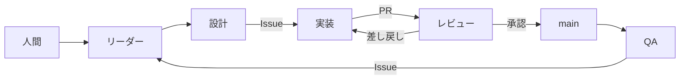

# 役割分担の開発フロー

人間 → リーダー → 各担当。受け渡しは GitHub の Issue と PR だけを使う。会話の中だけで決めたことは、Issue に書かれていない限り存在しないものとして扱う。

## 役割と成果物

| 役割 | 入力 | 成果物 | 完了条件 |
| --- | --- | --- | --- |
| リーダー | 人間の依頼 | Issue の割り当て、担当への指示 | 依頼が Issue になっている |
| 設計 | 依頼 | 設計文書＋Issue（受入条件つき） | 受入条件が検証可能な形で書かれている |
| 実装 | Issue | PR | Issue の受入条件をすべて満たし、検証ログがある |
| レビュー | PR | 承認または差し戻し | 受入条件を1つずつ確認した記録がある |
| QA | main | Issue（不具合・設計との乖離） | 再現手順が書かれている |

リーダーは自分でコードを書かない。設計と実装を同じ担当にしない。レビューは実装者と別の担当が行う。

## 流れ

## ゲートは3層

| 層 | 守るもの | 実装 | 強さ |
| --- | --- | --- | --- |
| サーバー | main へ直接入れない・承認1件必須・force push 不可・管理者も迂回不可 | GitHub のブランチ保護 | 書き方を変えても通らない |
| 認証 | エージェントが main を触れない | 管理者トークンを外し、GitHub App の installation token で動く | 権限が無いので不可能 |
| ローカル | 事故の予防 | `hooks/*.py`（pre_tool_call）、`githooks/pre-push` | 書き方を変えれば通る |

**ローカルのフックは安全装置ではない。** コマンド文字列を見て判断する以上、`git -C`、変数展開、別経路で抜けられる。レビューで2回、実際に抜けられた。だから main の防衛はサーバーと認証に置き、フックは「うっかり main を触る」事故を減らすためだけに使う。名前も安全装置とは呼ばない。

回帰テスト（`python3 harness/tests/test_hooks.py`、36本）は既知の書き方に対する回帰であって、健全性の証明ではない。

### サーバー側

public リポジトリでブランチ保護を有効にしてある（private の無料枠では API が 403 になる）。`enforce_admins=true`（管理者も迂回不可）、承認1件必須、linear history、force push と削除の禁止、会話の解決必須。

### 認証側

エージェントは管理者トークンを持たない。`gh auth logout` 済みで、`harness/tools/gh` と `git-credential-app.sh` が App の installation token を都度発行する。App には Contents / Issues / Pull requests / Workflows の書き込みだけを与え、Administration は与えない。**main への ref 更新は 422 で拒否される**（実測）。

トークン発行は PyJWT も cryptography も使わず、JWT の署名を openssl に任せる。

### ローカル側

| 止めるもの | 実装 |
| --- | --- |
| main 直 push・force push・main 上での commit | `githooks/pre-push`（git 自身が呼ぶ）と `hooks/git_guard.py` |
| レビュー前マージ | `git_guard.py`（承認マーカーをコメントで確認） |
| 領域外タップ | `adb_guard.py`（`assets/regions.json` の矩形のみ） |
| 画面の自動操作 | `adb_guard.py`（`input text/keyevent`、`monkey`、`sendevent`） |
| 他パッケージの画面読取 | `adb_guard.py`（前面が自パッケージのときだけ `uiautomator dump`） |

`regions.json` が空のあいだは、すべてのタップが止まる。座標は数字リテラルしか受け付けない。

## 承認とマージ

- PR は App 名義で作る。**App は自分の PR を承認できない**（GitHub の仕様）
- 承認は人間が押す。実装を回すエージェントに管理者権限を渡さないため、これが唯一意味のある分離
- 2つ目の App をレビュー用に置けば形式上の承認は機械でも付くが、鍵が同じ場所にあるなら分離は名目だけ
- マージは承認後にエージェントが実行してよい（`contents: write` で足りる）
- 承認が要るので、レビュー担当は「承認まで」ではなく「承認依頼まで」を担う

## 境界（ここは動かさない）

- エージェントは**自アプリの UI**を操作してよい。タップは `regions.json` に宣言された矩形の中だけ
- ゲーム画面の操作、`AccessibilityService`、メモリ読取、通信傍受は行わない
- MediaProjection の同意は人間が押す
- `INTERNET` 権限を宣言しない。`scripts/check-no-internet.sh` で機械的に検査する

テストのためにゲームを前面に出すことはあるが、それは「自アプリのオーバーレイを検証する」場合に限る。ゲームを進める操作はしない。

## サブエージェントに渡すときの型

`delegate_task` の子は会話を共有しない。次を必ず入れる。

1. リポジトリの絶対パスと、作業するブランチ名
2. 対象 Issue 番号と、そこに書かれた受入条件の全文
3. 触ってよいファイル、触ってはいけないファイル
4. 完了時に返すもの（PR 番号、検証コマンドの出力、未解決点）
5. 「質問できない」前提で、曖昧なら止まって報告する指示

子の報告は自己申告なので、PR の存在と CI の結果はリーダーが `gh` で確認する。

## QA の点検項目

定期実行で次を見て、崩れていれば Issue を立てる。

- `main` がビルドできる（`scripts/abuild.sh assembleDebug`）
- `scripts/check-no-internet.sh` が通る
- `assets/regions.json` と画面の実測がずれていない（未確定項目の再確認）
- 放置された PR（7日以上）と、受入条件が空の Issue
- 設計文書と実装の食い違い（設計に無い機能が入っていないか）

## 失敗の扱い

- フックに止められたら、迂回せずに理由を読む。迂回が必要なら人間に判断を仰ぐ
- レビューで差し戻されたら、Issue の受入条件に戻る。PR の上で条件を足さない
- 役割を飛ばしたくなったら、それは Issue の粒度が大きすぎる合図
