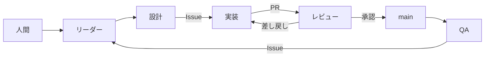

# 役割分担の開発フロー

人間 → リーダー → 各担当。受け渡しは GitHub の Issue と PR だけを使う。会話の中だけで決めたことは、Issue に書かれていない限り存在しないものとして扱う。

## 役割と成果物

| 役割 | 入力 | 成果物 | 完了条件 |
| --- | --- | --- | --- |
| リーダー | 人間の依頼 | Issue の割り当て、担当への指示 | 依頼が Issue になっている |
| 設計 | 依頼 | 設計文書＋Issue（受入条件つき） | 受入条件が検証可能な形で書かれている |
| 実装 | Issue | PR | Issue の受入条件をすべて満たし、検証ログがある |
| レビュー | PR | 承認または差し戻し | 受入条件を1つずつ確認した記録がある |
| QA | main | Issue（不具合・設計との乖離） | 再現手順が書かれている |

リーダーは自分でコードを書かない。設計と実装を同じ担当にしない。レビューは実装者と別の担当が行う。

## 流れ

## 決定論的ゲート

会話の指示ではなく、フックで機械的に止める。`harness/hooks/` にあり、`harness/install.sh` で `pre_tool_call` に取り付ける。

| ゲート | 止めるもの | 実装 |
| --- | --- | --- |
| main 直 push | `git push` の refspec に main/master | `git_guard.py` |
| main 上での commit | 保護リポジトリで現在ブランチが main | `git_guard.py` |
| force push | `--force` / `-f` | `git_guard.py` |
| レビュー前マージ | `gh pr merge` で `reviewDecision != APPROVED`、または `--squash` 無し | `git_guard.py` |
| 領域外タップ | `input tap` が `assets/regions.json` の外 | `adb_guard.py` |
| 画面の自動操作 | `input text/keyevent`、`monkey`、`sendevent` | `adb_guard.py` |
| 他パッケージの画面読取 | 前面が自パッケージでないときの `uiautomator dump` | `adb_guard.py` |

**ブランチ保護は private リポジトリ（無料枠）では使えない**（API が 403 を返す）。したがってサーバー側の強制は無く、このローカルフックが唯一の決定論的ゲートになる。フックを外すと規律だけが残る。

`fail_closed: true` を付けているので、スクリプトが落ちた場合はツール呼び出しが通らず止まる。

## 境界（ここは動かさない）

- エージェントは**自アプリの UI**を操作してよい。タップは `regions.json` に宣言された矩形の中だけ
- ゲーム画面の操作、`AccessibilityService`、メモリ読取、通信傍受は行わない
- MediaProjection の同意は人間が押す
- `INTERNET` 権限を宣言しない。`scripts/check-no-internet.sh` で機械的に検査する

テストのためにゲームを前面に出すことはあるが、それは「自アプリのオーバーレイを検証する」場合に限る。ゲームを進める操作はしない。

## サブエージェントに渡すときの型

`delegate_task` の子は会話を共有しない。次を必ず入れる。

1. リポジトリの絶対パスと、作業するブランチ名
2. 対象 Issue 番号と、そこに書かれた受入条件の全文
3. 触ってよいファイル、触ってはいけないファイル
4. 完了時に返すもの（PR 番号、検証コマンドの出力、未解決点）
5. 「質問できない」前提で、曖昧なら止まって報告する指示

子の報告は自己申告なので、PR の存在と CI の結果はリーダーが `gh` で確認する。

## QA の点検項目

定期実行で次を見て、崩れていれば Issue を立てる。

- `main` がビルドできる（`scripts/abuild.sh assembleDebug`）
- `scripts/check-no-internet.sh` が通る
- `assets/regions.json` と画面の実測がずれていない（未確定項目の再確認）
- 放置された PR（7日以上）と、受入条件が空の Issue
- 設計文書と実装の食い違い（設計に無い機能が入っていないか）

## 失敗の扱い

- フックに止められたら、迂回せずに理由を読む。迂回が必要なら人間に判断を仰ぐ
- レビューで差し戻されたら、Issue の受入条件に戻る。PR の上で条件を足さない
- 役割を飛ばしたくなったら、それは Issue の粒度が大きすぎる合図
